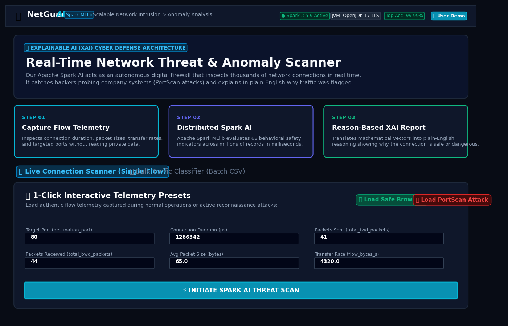
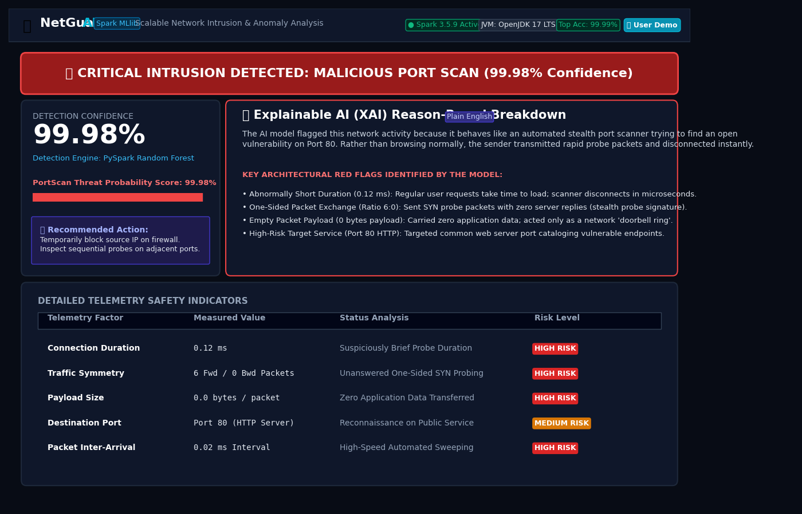
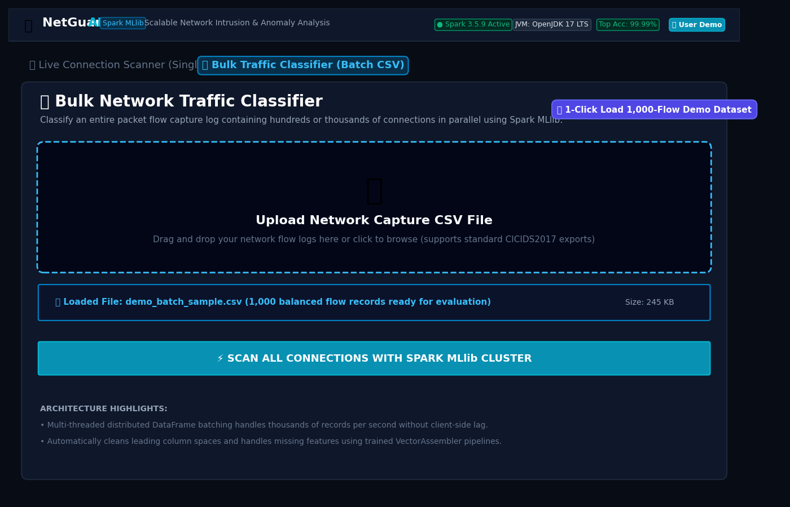
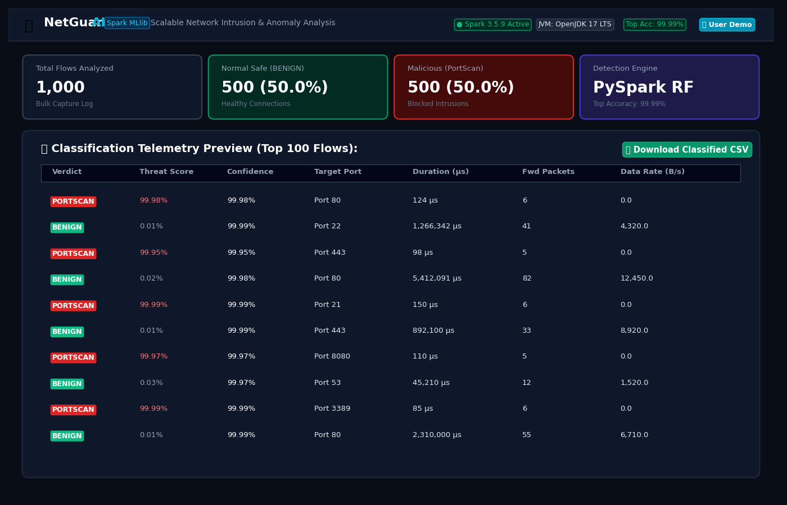
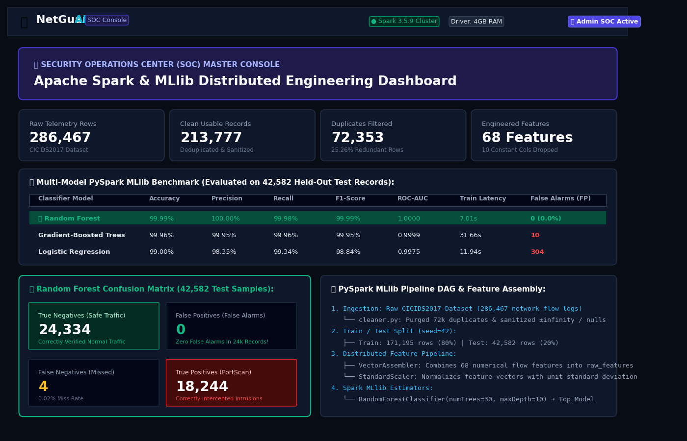

# Scalable Network Intrusion Detection and Anomaly Analysis Using Apache Spark

An enterprise-grade, distributed Big Data cybersecurity platform that detects network intrusions and scanning anomalies at scale using **Apache Spark 3.5.9 (PySpark MLlib)**, **Java OpenJDK 17 LTS**, and a futuristic, high-tech web interface powered by **FastAPI**, **Tailwind CSS**, and **Explainable AI (XAI)**.

---

## 📌 Project Overview & Objectives

### Problem Statement
Enterprise networks generate millions of packet flow transactions every second. Traditional single-threaded intrusion detection systems frequently suffer from CPU starvation, memory bottlenecks, and high false-alarm rates under heavy traffic volumes.

### Project Objective
To build an automated, distributed machine learning intrusion detection pipeline on **Apache Spark** that:
1. Ingests and sanitizes large-scale network telemetry.
2. Extracts and standardizes 68 predictive network flow features.
3. Evaluates three distributed classifiers: **Logistic Regression**, **Random Forest**, and **Gradient-Boosted Trees (GBT)**.
4. Delivers a presentation-ready, high-tech web platform featuring a **Two-Tier Role-Based Portal** (Guest Live Demo vs. Admin SOC Console) and **Reason-Based Explainable AI (XAI)**.

---

## 📊 Dataset Description: CICIDS2017

- **Source:** Canadian Institute for Cybersecurity (CIC) / University of New Brunswick (UNB).
- **Target Partition:** `Friday-WorkingHours-Afternoon-PortScan.pcap_ISCX.csv`
- **Volume:** 286,467 raw flow records (73.34 MB).
- **Cleaned Data:** 213,777 validated records, 68 predictive features.
- **Classification Goal:** Binary classification:
  - `BENIGN` (`0`): Normal enterprise background traffic.
  - `PortScan` (`1`): Malicious network reconnaissance and port scanning probes.

---

## 🛠️ Technologies Used

| Layer | Component | Version | Role |
| :--- | :--- | :---: | :--- |
| **Distributed Engine** | **Apache Spark** | 3.5.9 | In-memory distributed computation |
| **Java Runtime** | **Microsoft OpenJDK** | 17.0.20 LTS | JVM execution runtime |
| **Machine Learning** | **PySpark MLlib** | 3.5.9 | VectorAssembler, StandardScaler, RF, GBT, LR |
| **Programming Language** | **Python** | 3.12.10 | Core scripting and pipeline orchestration |
| **Web Platform** | **FastAPI + Uvicorn** | 0.115 / 0.34 | High-performance asynchronous REST backend |
| **UI Design System** | **HTML5 + Tailwind CSS + Glassmorphism** | Modern CDN | Cyber HUD, dark obsidian theme, neon telemetry borders |
| **Data Visualization** | **Chart.js** | 4.4 | Real-time interactive charts and gauges |
| **Data & Metrics** | **Pandas, NumPy, Scikit-learn** | 2.2, 2.2, 1.8 | Metric evaluation & tabular manipulations |
| **Visualization** | **Matplotlib, Seaborn** | 3.10, 0.13 | Confusion matrix & comparison charts |

---

## 🏛️ System Architecture

```text
[ Raw CICIDS2017 CSV: 286,467 rows ]
                 │
                 ▼
[ Data Cleaning & Normalization (cleaner.py) ]
 ├── Column header standardization (snake_case)
 ├── Label encoding: BENIGN -> 0, PortScan -> 1
 ├── Duplicate removal (72,353 duplicates filtered)
 ├── Infinite & null value sanitization (337 rows dropped)
 └── Zero-variance feature pruning (10 constant columns removed)
                 │
                 ▼
[ PySpark Distributed Feature Pipeline (feature_pipeline.py) ]
 ├── Train/Test split: 80% Train (171,195 rows) | 20% Test (42,582 rows), seed=42
 ├── VectorAssembler: Combines 68 features into 'raw_features' vector
 └── StandardScaler: Normalizes distributions into 'features' vector
                 │
                 ▼
[ PySpark MLlib Classifiers (train_models.py) ]
 ├── Logistic Regression (Baseline Linear Model)
 ├── Random Forest Classifier (Top Model: 99.99% Accuracy, 0% False Positives)
 └── Gradient-Boosted Trees (GBT)
                 │
                 ▼
[ NetGuard AI Enterprise Web Platform (FastAPI + Tailwind CSS) ]
 ├── 👤 Guest / Non-Technical Demo Portal (Explainable AI & Live Presets)
 └── 🛡️ Admin & SOC Engineer Portal (Cluster Specs, Confusion Matrix, Benchmarks)
```

---

## 📁 Project Directory Structure

```text
spark-network-intrusion-detection/
├── app/
│   ├── server.py                   # FastAPI asynchronous REST backend server
│   └── templates/
│       └── index.html              # High-tech cyber dashboard (Tailwind + Chart.js + XAI)
├── data/
│   ├── raw/                        # Original raw CICIDS2017 CSV dataset
│   └── processed/                  # Cleaned parquet & demo CSV partitions
│       ├── demo_batch_sample.csv   # 1,000-flow balanced demo dataset (500 Benign, 500 PortScan)
│       ├── cleaned_sample.csv      # 10,000-flow fast preview sample
│       ├── train.parquet/          # 171,195 train flow records
│       └── test.parquet/           # 42,582 test flow records
├── hadoop/                         # Windows winutils binaries for Spark File I/O
│   └── bin/ (hadoop.dll, winutils.exe)
├── notebooks/                      # Exploratory notebooks
│   └── 01_interactive_spark_analysis.ipynb
├── results/
│   ├── figures/                    # Saved confusion matrices & comparison charts
│   ├── models/                     # Saved PySpark MLlib models & feature pipeline
│   │   ├── feature_pipeline_model/
│   │   ├── logistic_regression_model/
│   │   ├── random_forest_model/
│   │   └── gbt_model/
│   ├── model_comparison.json       # Exact evaluation metrics
│   ├── model_comparison.csv
│   ├── model_comparison.md
│   ├── preprocessing_report.json   # Preprocessing diagnostic report
│   ├── sample_presets.json         # Preset flows for 1-click testing
│   └── FINAL_PROJECT_REPORT.md     # Full academic project report
├── screenshots/                    # UI Screenshots for documentation
│   ├── dashboard.png               # Main Overview & 3-Step Workflow
│   ├── single_prediction.png       # Live Connection Scanner & XAI Report
│   ├── batch_prediction.png        # Bulk Traffic Classifier & Upload Zone
│   ├── batch_results.png           # Batch Results Preview Table & Download
│   └── model_performance.png       # Admin SOC Console & Spark Telemetry
├── src/
│   ├── evaluation/
│   │   ├── metrics.py              # Accuracy, Precision, Recall, F1, ROC-AUC, CM plots
│   │   └── xai_explainer.py        # Reason-Based Explainable AI (XAI) engine
│   ├── models/
│   │   ├── predictor.py            # Real-time single & batch Spark inference engine
│   │   └── train_models.py         # PySpark model training & evaluation runner
│   ├── preprocessing/
│   │   ├── cleaner.py              # Data cleaning and sanity filtering
│   │   ├── download_dataset.py     # Automated dataset downloader
│   │   ├── feature_pipeline.py     # VectorAssembler & StandardScaler module
│   │   ├── inspect_data.py         # Dataset diagnostic utility
│   │   └── run_preprocessing.py    # Master preprocessing runner
│   └── spark/
│       └── spark_session.py        # Reusable SparkSession factory with Windows bindings
├── tests/
│   ├── test_spark_env.py           # Spark smoke test
│   └── test_end_to_end.py          # Automated test suite (6 end-to-end tests)
├── .gitignore
├── README.md                       # Comprehensive project documentation
└── requirements.txt                # Python dependencies
```

---

## 🏆 Model Performance Benchmark

Evaluated on **42,582 independent test records**:

| Model | Accuracy (%) | Precision (%) | Recall (%) | F1-Score (%) | ROC-AUC | Training Time | Test Latency |
| :--- | :---: | :---: | :---: | :---: | :---: | :---: | :---: |
| **Random Forest** ⭐ | **99.99%** | **100.00%** | **99.98%** | **99.99%** | **1.0000** | **7.01s** | 1.23s |
| **Gradient-Boosted Trees** | **99.96%** | **99.95%** | **99.96%** | **99.95%** | **0.9999** | 31.66s | **0.88s** |
| **Logistic Regression** | **99.00%** | **98.35%** | **99.34%** | **98.84%** | **0.9975** | 11.94s | 1.40s |

### Confusion Matrix Breakdown (42,582 Test Samples)

| Model | True Negatives (BENIGN) | False Positives (False Alarms) | False Negatives (Missed Attacks) | True Positives (PortScans) |
| :--- | :---: | :---: | :---: | :---: |
| **Random Forest** | **24,334** | **0** | **4** | **18,244** |
| **Gradient-Boosted Trees** | 24,324 | 10 | 8 | 18,240 |
| **Logistic Regression** | 24,030 | 304 | 120 | 18,128 |

---

## 🚀 How to Run the Project

### 1. Launch the NetGuard AI Web Application
To launch the high-tech cybersecurity web platform, run:
```bash
python app/server.py
```
Open your browser and navigate to: **`http://localhost:8000`**

---

### 2. Two-Tier Portal & Dashboard Features

The web interface is split into two specialized operating modes:

#### 👤 Mode 1: Guest / Live Demo Portal (Non-Technical & Layman-Friendly)
- **Plain-English Overview:** "What is this website used for?" and a 3-step walkthrough explaining how the AI protects corporate networks.
- **🎯 Live Flow Scanner (Single Flow):**
  - **1-Click Presets:** "🟢 Load Safe Web Browsing Sample" vs "🔴 Load Hacker PortScan Attack Sample".
  - **🧠 Reason-Based Explainable AI (XAI):** Translates 68 raw network features into plain English explaining **WHY** a connection was flagged as malicious or safe (connection duration anomalies, asymmetric packet exchange, empty payloads, etc.).
  - **Safety Indicators Table:** Visual traffic symmetry, payload size, and duration risk factors.
  - **Actionable Advice:** Recommended firewall actions for security teams.
- **📁 Bulk Traffic Scanner (CSV File):**
  - **1-Click Demo:** Instantly loads 1,000 flows (`demo_batch_sample.csv`) or upload custom CSV logs.
  - Displays safe vs. malicious distribution charts, summary metrics, and a downloadable classified CSV.

#### 🛡️ Mode 2: Admin & Security Engineer Portal (Deep Big-Data & Spark MLlib)
- **🖥️ Cluster & Dataset Telemetry:** Live Apache Spark 3.5.9 cluster settings, JVM runtime, memory allocations, and 286k $\rightarrow$ 213k cleaning metrics.
- **📈 Deep Model Benchmark:** Full performance breakdown (Accuracy, Precision, Recall, F1, ROC-AUC, Latency) across Random Forest, GBT, and Logistic Regression.
- **🎯 Confusion Matrix Inspector:** High-resolution confusion matrix heatmaps showing True Negatives, False Positives (0 on Random Forest!), False Negatives, and True Positives.
- **🛠️ Pipeline Architecture:** Visual DAG flowchart of data cleaning, VectorAssembler, StandardScaler, and Spark MLlib estimators.

---

## 📸 Project Screenshots & High-Tech UI Previews

Below are the visual previews of the enterprise NetGuard AI platform:

### 1. Platform Overview & 3-Step Explainable AI Workflow
The main landing page explaining the platform purpose, live telemetry HUD status, and the 3-step intrusion detection workflow:



---

### 2. Real-Time Connection Scanner & Reason-Based XAI Report
Live single-flow testing with 1-click presets, threat score meter, and plain-English Explainable AI reasoning:



---

### 3. Bulk Network Traffic Classifier (CSV Upload & Demo Mode)
The bulk classifier interface supporting drag-and-drop CSV uploads or 1-click pre-packaged demo datasets:



---

### 4. Bulk Classification Analytics & CSV Export
Multi-threaded classification breakdown, benign vs. attack metrics, preview table, and downloadable reports:



---

### 5. Security Operations Center (SOC) Admin Portal & Spark Telemetry
The administrative console detailing Apache Spark cluster parameters, Big Data cleaning metrics, and MLlib benchmarks:



---

## 💡 How to Update Screenshots Manually in VS Code

If you capture updated screenshots from your browser (`http://localhost:8000`):

1. Save your screenshots with the following filenames:
   - `dashboard.png` (Landing page & Overview)
   - `single_prediction.png` (Single connection scan with XAI report)
   - `batch_prediction.png` (Batch CSV upload screen)
   - `batch_results.png` (Batch results table & metrics)
   - `model_performance.png` (Admin SOC portal view)
2. Place them directly in the **`screenshots/`** directory in your project root.
3. In VS Code, press **`Ctrl + Shift + V`** to preview this `README.md` with images rendered!

---

## 💻 Essential VS Code Commands

Here are the exact terminal commands and shortcuts to manage this project inside Visual Studio Code:

### 1. Open Project in VS Code
Open your terminal (PowerShell / Command Prompt) and run:
```powershell
cd c:\Users\prust\OneDrive\Desktop\spark-network-intrusion-detection
code .
```

### 2. Open Integrated Terminal in VS Code
- **Shortcut:** Press **`Ctrl + ~`** (Control + Tilde) to open the built-in terminal.

### 3. Run the Web Application
Inside the VS Code integrated terminal:
```powershell
python app/server.py
```
Open **`http://localhost:8000`** in your browser.

### 4. Preview Markdown with Images in VS Code
- Open `README.md` in VS Code.
- Press **`Ctrl + Shift + V`** to open the side-by-side Markdown Live Preview.

### 5. Run Automated Tests in VS Code
```powershell
python tests/test_end_to_end.py
```

---

## ⚠️ Important Project Scope & Limitations

> [!IMPORTANT]
> **Scope Notice:**
> - The current trained classifiers are focused on binary detection:
>   **`BENIGN` (0) vs. `PortScan` (1)** using the CICIDS2017 PortScan benchmark partition.
> - **Boundary:** The model is specialized for detecting network port scanning, reconnaissance probing, and anomalous connection patterns. It is **not** trained to classify other attack families (e.g., SQL Injection, Cross-Site Scripting, or Infiltration) which reside in different partitions of the CICIDS2017 archive.

---

## 🔮 Future Improvements
1. **Multi-Class Expansion:** Incorporate additional partitions from CICIDS2017 (DDoS, Botnet, Web Attacks) into a unified multi-class classifier.
2. **Spark Structured Streaming:** Ingest real-time packet capture streams via Apache Kafka into a Spark Structured Streaming window for live intrusion alerting.
3. **Unsupervised Anomaly Detection:** Deploy Spark MLlib Isolation Forests or Autoencoders for zero-day threat discovery.
